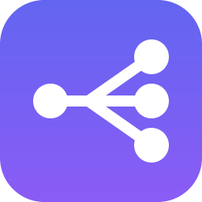
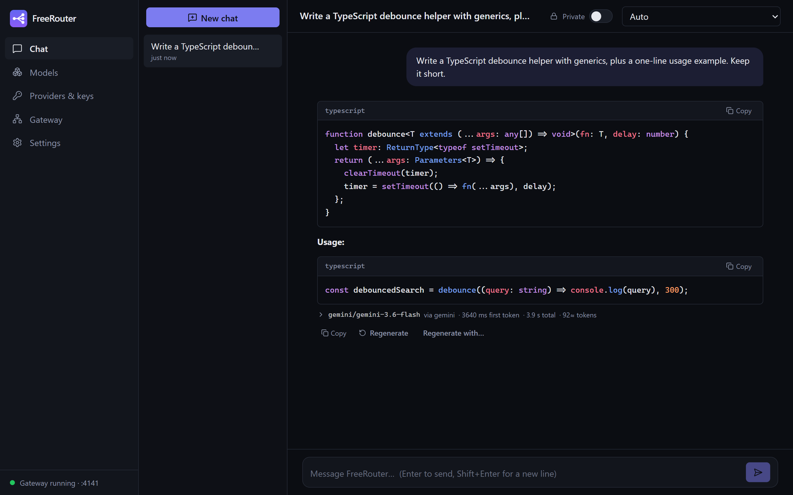
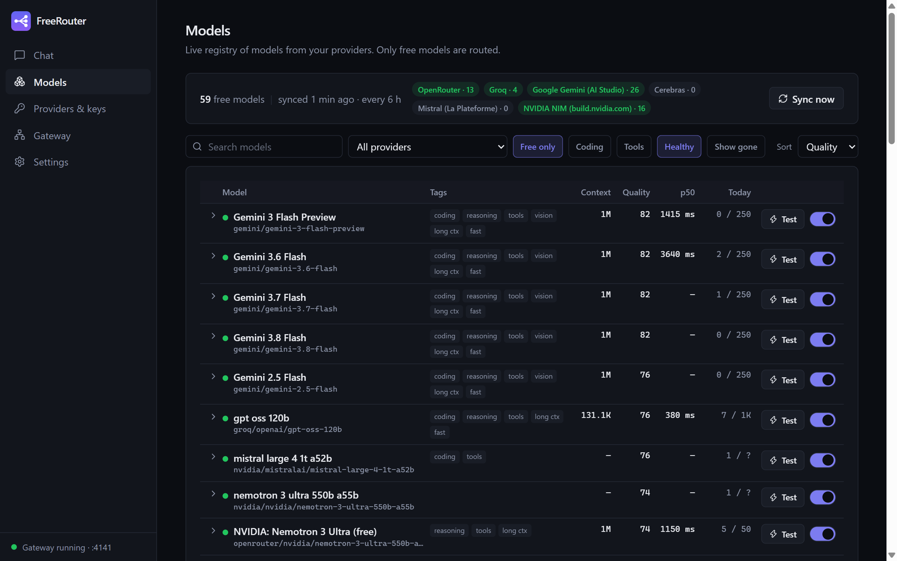
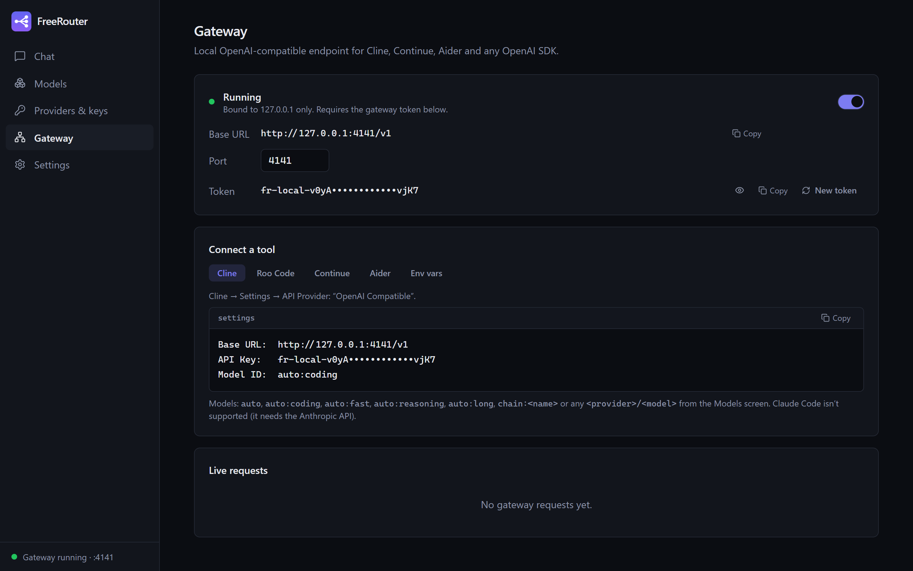
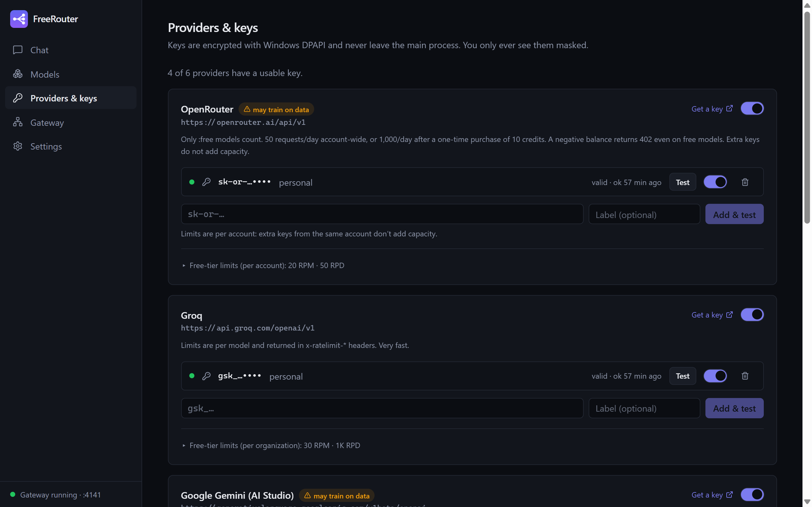
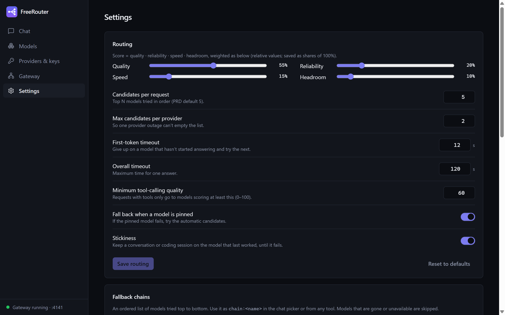
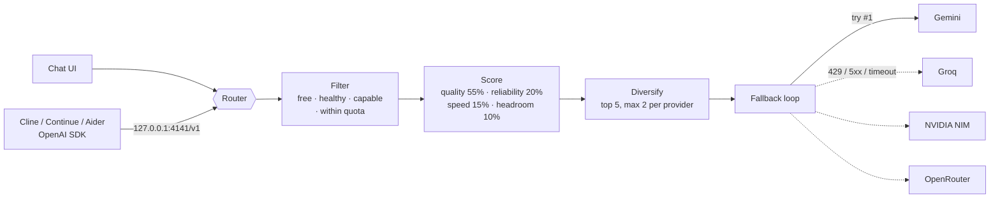

<div align="center">



# FreeRouter

**Many free LLM tiers, one endpoint, zero bills.**

A Windows desktop app that pools the free tiers of hosted LLM providers behind one smart router,<br/>
with a chat UI for you and an OpenAI-compatible gateway for your coding tools.




</div>

---

## Why

OpenRouter, Groq, Google Gemini and NVIDIA NIM all give away real LLM capacity for free, but each one has
its own rate limits, daily caps, quirks and models that disappear without notice. Juggle them by hand and
you hit a `429` halfway through your work.

**FreeRouter juggles them for you.** It keeps a live registry of every free model across your providers,
scores them, and sends each request to the best one available *right now*. When a model is rate-limited,
out of quota, retired or slow, it falls back to the next candidate before the first token reaches you.

## Features

- 🧠 **Smart routing.** Every request is scored on quality, reliability, speed and remaining quota, across 50+ free models.
- 🔁 **Invisible failover.** `429`s, `5xx`s, timeouts and dead models are skipped automatically. You see which models were tried, and why.
- 🔌 **OpenAI-compatible gateway** on `127.0.0.1:4141/v1`. Point **Cline, Roo Code, Continue, Aider** or any OpenAI SDK at it.
- 🎯 **Routing intents.** Use `auto`, `auto:coding`, `auto:fast`, `auto:reasoning` or `auto:long`, pin an exact model, or build your own `chain:` of models.
- 📊 **Live model registry.** Synced every 6 h, with capability tags, quality scores, p50 latency and today's usage against each limit.
- 🧷 **Sticky sessions.** A conversation or coding session stays on the model that is working, until it isn't.
- 🛡️ **Private mode.** Excludes providers whose free tier may log or train on your prompts, for chat, the gateway or both.
- 💬 **Chat with Markdown and code**, plus *Regenerate with…* another model and *Continue with another model* after a mid-stream failure.
- 📈 **Quota-aware.** Tracks per-minute and per-day limits locally and reads `x-ratelimit-*` headers to stay ahead of them.

## Screenshots

<table>
  <tr>
    <td width="50%"><br/><sub><b>Models:</b> a live registry of every free model, with tags, quality, p50 latency and today's usage.</sub></td>
    <td width="50%"><br/><sub><b>Gateway:</b> copy-paste setup for Cline, Roo Code, Continue and Aider.</sub></td>
  </tr>
  <tr>
    <td width="50%"><br/><sub><b>Providers & keys:</b> encrypted with Windows DPAPI and only ever shown masked.</sub></td>
    <td width="50%"><br/><sub><b>Settings:</b> tune the scoring weights, timeouts, fallback and stickiness.</sub></td>
  </tr>
</table>

## How routing works



Every failure is classified and remembered:

| What happened | What FreeRouter does |
|---|---|
| `429` rate limit | Cools the model down until the reset; reliability score untouched |
| Daily cap hit | Parks the model until the quota resets |
| Zero free quota (`limit: 0`) or `404` | Takes the model out for 7 days: this account can't use it |
| `5xx`, timeout, no first token | Lowers reliability; 3 in a row cools the model down for 5 min |
| `401`/`403` | Flags the key as invalid and moves on |
| `400` (context too long, unsupported parameter) | Skips the model for this request only |

## Supported providers

| Provider | Free tier | Notes |
|---|---|---|
| **Google Gemini** (AI Studio) | ✅ | Flash-class models are the workhorses; long context |
| **Groq** | ✅ | Very fast, per-model limits |
| **NVIDIA NIM** (build.nvidia.com) | ✅ | Large catalogue, about 40 requests/min |
| **OpenRouter** | ✅ | `:free` models; 50 requests/day account-wide |
| Cerebras | ⚠️ | Off by default: needs a card as of Nov 2026 |
| Mistral (La Plateforme) | ⚠️ | Off by default: API keys need billing as of Nov 2026 |

Providers are **data, not code**. Each one is a profile in [`providers.json`](src/core/providers/providers.json)
(limits, key validation, model-list parsing and request quirks), so adding one rarely needs new logic.

## Getting started

### Install

1. Build the installer (see [Build from source](#build-from-source)), or grab one from Releases when it's published.
2. Run `FreeRouter Setup <version>.exe`. The installer isn't code-signed yet, so Windows SmartScreen will ask you to confirm.

### Add your free keys

Open **Providers & keys**, click **Get a key ↗** on each provider, paste the key and press **Add & test**.
Every key is checked against the provider before it's saved. Two or three providers is plenty to start.

### Connect a coding tool

Open **Gateway**, pick your tool and press **Copy**. For Cline:

| Setting | Value |
|---|---|
| API Provider | OpenAI Compatible |
| Base URL | `http://127.0.0.1:4141/v1` |
| API Key | your `fr-local-…` token from the Gateway screen |
| Model ID | `auto:coding` |

Or use it from code:

```ts
import OpenAI from 'openai'

const client = new OpenAI({ baseURL: 'http://127.0.0.1:4141/v1', apiKey: process.env.FREEROUTER_TOKEN })

const stream = await client.chat.completions.create({
  model: 'auto:coding',
  messages: [{ role: 'user', content: 'Explain this regex: ^(?=.*\\d).{8,}$' }],
  stream: true
})
for await (const chunk of stream) process.stdout.write(chunk.choices[0]?.delta?.content ?? '')
```

Each response says which model answered, in the `x-fr-provider`, `x-fr-model` and `x-fr-attempts` headers.

**Optional request headers:**
- `x-fr-private: 1` excludes providers that may train on prompts.
- `x-fr-session` keeps a session on one model.
- `x-fr-min-context` sets a minimum context window.

## Security & privacy

- **Keys never leave your machine.** They're encrypted with Electron `safeStorage` (Windows DPAPI) and decrypted only in the main process at call time. The UI only ever sees masked values such as `gsk_…a91f`.
- **The gateway is local-only.** It binds to `127.0.0.1` only, requires a token, rejects foreign `Host` headers (DNS rebinding) and blocks browser origins unless you allow-list them.
- **Your prompts stay private.** The request log is metadata only: models, timings, status. Prompts and replies are never logged.
- **The app is locked down.** The window runs with `contextIsolation`, `sandbox`, a strict CSP and an allow-listed, Zod-validated IPC surface. Model output is rendered without raw HTML.

## Build from source

Requires Windows 10/11, **Node 22+** and **pnpm 10**.

```powershell
pnpm install
pnpm dev          # run with hot reload
pnpm test         # 200 Vitest tests (no Electron needed)
pnpm typecheck
pnpm package      # NSIS installer -> dist/FreeRouter Setup <version>.exe (~110 MB)
```

To try it end to end without any real keys: run `pnpm dev:fake`, then start the app with
`FREEROUTER_DATA_DIR=<temp dir>` and `FREEROUTER_DEV_FAKE_PROVIDER=<printed URL>`.

### Architecture

```
src/
  core/       pure TypeScript, no Electron: router, failure classification, quota tracker,
              model registry, provider catalog, key vault, chat service, gateway (Fastify)
  main/       Electron main process: window hardening, tray, SQLite, IPC handlers
  preload/    contextBridge with allow-listed channels only
  renderer/   React 19 + Tailwind v4 + Zustand + TanStack Query
tests/        Vitest suites, including a real HTTP fake provider for router scenarios
```

`src/core` never imports Electron, and an architecture test enforces it. That keeps the router testable
in plain Node, with scripted failures such as 429s, mid-stream breaks and slow first tokens.

## Disclaimer

FreeRouter isn't affiliated with any of the providers above. Free tiers, limits and model line-ups change
often, so please respect each provider's terms of service.
